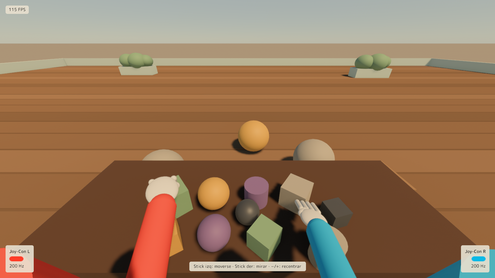

# joyreach

**Dos Joy-Con como tus brazos dentro de un mundo 3D en el monitor: manos estilo VR, sin visor.**



Cada Joy-Con (L/R) maneja un brazo virtual. El giroscopio y el acelerómetro dan la orientación de la mano (3DoF), y un modelo de brazo deduce dónde está el codo y la muñeca. Con las manos se empujan objetos con física real. La meta final es tener tus apps de escritorio (primero el navegador) como objetos dentro del mundo.

## Probarlo

Requisitos: Windows 11, Rust estable (≥ 1.97.1), Visual Studio con C++ y CMake (SDL3 se compila estático), y dos Joy-Con emparejados por Bluetooth.

```powershell
cargo run                      # el primer build compila Bevy (~25 min); después, ~20 s
cargo run --example joycon_probe -- --secs 20   # diagnóstico de los Joy-Con en consola
```

Sin hardware: `$env:JOYREACH_FAKE='1'; cargo run` anima las manos con input falso (a los 2.2 s agarra un prop y lo muestra, para capturas). `cargo run -- --screenshot shot.png` guarda una captura a los 4 s y sale. `JOYREACH_PITCH=-70` arranca la cámara mirando a ese pitch (en grados), útil para capturar el agachado automático. `cargo run --example joycon_probe -- --secs 4 --rumble` prueba la vibración: izquierda y después derecha, 300 ms cada una.

## Calibración del IMU

Cada Joy-Con tiene errores de escala y offset distintos por eje (en reposo, el izquierdo mide ~10.1 m/s² y el derecho ~8.9 según la pose). Si solo se resta un escalar de gravedad, girar la muñeca se integra como una pequeña traslación y la mano "nada" sola. La calibración mide seis poses quietas por mano y guarda un ajuste por eje:

```powershell
cargo run --example joycon_probe -- --calibrate
```

Apoyá los dos Joy-Con juntos y seguí las seis poses que pide la consola (cara de botones arriba, abajo, los dos rieles y los dos extremos); cada una tiene que quedar quieta ~1 s. El probe exige que las poses sean distintas, imprime el RMS de `|a| − 9.80665` antes y después, y guarda `%LOCALAPPDATA%\joyreach\imu_calib.txt`. El juego lo carga al arrancar (`[joycon] accel calibration loaded` en stderr); si no existe, sigue con el fallback escalar anterior. Es opcional, pero hay dos mejoras de M2c que van juntas: la calibración deja `|a|` exacto en cualquier pose y el filtro deja de confiar en el acelerómetro mientras girás, para que la aceleración centrípeta no incline el puntero.

Para grabar una sesión real (reposo, giro de muñeca, empuje de 30 cm y alto) y poder ajustar con datos:

```powershell
cargo run --example joycon_probe -- --secs 20 --record sesion.csv
```

El CSV guarda `ts_ns,hand,gx,gy,gz,ax,ay,az` por muestra cruda; los tests lo pueden reproducir por `ImuFusion` + `ReachTracker`.

La profundidad IMU de la mano (`HandInput::reach`) es **opt-in**: se enciende con `$env:JOYREACH_REACH='1'`. Por defecto los brazos son solo orientación (la pose del modelo intacta) y la distancia va a manejarse con un rayo desde la palma, no con dead reckoning.

## Controles

| Joy-Con | Acción |
|---|---|
| Sostenlos como un control remoto: punta (ZL/ZR) hacia la pantalla, cara hacia arriba | Pose neutra de las manos |
| − o + | Recentrar el giro horizontal de ambas manos |
| Stick izquierdo / derecho | Moverse / mirar |
| B (Joy-Con R) o Space | Saltar (~0.6 m de alto), solo desde el piso |
| Clic del stick izquierdo (o C / Ctrl) | Agacharse fijo: los ojos bajan a ~0.95 m y el paso se hace más lento |
| Mirar hacia abajo (−35° a −80°) | Agacharse automático hasta ~0.90 m: las manos bajan con los ojos hasta el piso |
| ZL / ZR | Agarrar: si el prop está a ≤12 cm de la palma lo toma la mano; si no, el rayo de la palma lo toma a distancia (hasta 8 m). Al soltar, lo lanza |
| Girar la muñeca con un prop en el rayo | El prop rota igual que la mano |
| ↑ / ↓ (Joy-Con L) · X / Y (Joy-Con R), o E / Q | Alejar / acercar el prop que sostiene el rayo (0.35–8 m, 1.5 m/s) |
| Mirar hacia abajo (>20°) | El torso se inclina y las manos alcanzan donde mirás |

Teclado y mouse para desarrollo: WASD para moverse, Space para saltar, C o Ctrl para agacharse, y clic para capturar el mouse (Esc lo suelta).

## Cómo funciona

- **Input (`src/joycon.rs`):** SDL3 corre en su propio hilo con el driver HIDAPI de Switch. Integra cada muestra del IMU (~200–350 Hz por Bluetooth) con su marca de tiempo en un filtro Mahony por mano. La deriva del giroscopio se calibra sola cuando el control está quieto y la corrección de tilt del acelerómetro se atenúa mientras la mano gira (así el puntero no se inclina con la aceleración centrípeta). Con `--calibrate`, un ajuste por eje del acelerómetro deja `|a| = 9.80665 m/s²` en cualquier orientación; el archivo se carga al arrancar. El juego solo lee el recurso `Hands`. El HD Rumble va en sentido inverso: el juego escribe mensajes `Rumble` y el hilo de SDL los manda al Joy-Con que corresponde (en un par combinado, graves = izquierda, agudos = derecha; `SDL_hidapi_switch.c`).
- **Brazos (`src/arms.rs`):** port del `GvrArmModel` de Google Daydream. Al inclinar el Joy-Con hacia arriba, el codo absorbe parte de la rotación y el brazo se estira, en vez de girar solo la muñeca. Por defecto el brazo es **solo orientación**: `HandInput::reach` queda en cero y la pose es exactamente la del modelo. La profundidad IMU de M2a sigue disponible con `JOYREACH_REACH=1` (acelerómetro integrado, ZUPT al quedarse quieto, tope de 0.35 m); el codo se resuelve con IK analítica de dos huesos hacia la muñeca desplazada. Cada mano es un cuerpo cinemático de avian3d que persigue su objetivo por velocidad, así los objetos reciben un empujón con inercia real. Si mirás abajo de −20°, todo el ancla de los hombros baja y avanza con la mirada.
- **Agarre (`src/grab.rs`):** en el borde de ZL/ZR busca el prop cuyo collider esté a ≤12 cm de la palma (la mano más cercana gana si ambas lo alcanzan). Al agarrarlo lo acomoda en la palma en ~80 ms y después le fija la velocidad con un límite de 60 N: la mesa puede bloquearlo y lo pesado (~3 kg) se queda atrás mientras lo liviano (~0.3 kg) va pegado. Al soltar lo lanza con el promedio de la velocidad de la mano en los últimos 5 pasos × 1.1 (máx. 12 m/s). El contorno es un casco invertido del mismo mesh, sin luz, del color de la mano.
- **Rayo de la palma (`src/handray.rs`, `src/grab.rs`):** cada mano lanza un rayo desde la palma en la dirección a la que apunta el Joy-Con. Solo usa la orientación, que es lo que el IMU mide bien, así que no deriva. Si no hay nada al alcance de la mano, ZL/ZR toma el prop que toca el rayo y lo sostiene a esa distancia con el mismo resorte de 60 N: los objetos pesados se retrasan. La rotación de la mano desde el agarre se aplica al prop. Al soltar conserva su velocidad (× 1.1), así que un golpe de muñeca lo lanza. El mismo `HandRay` será el puntero de las ventanas en M3.
- **Cuerpo (`src/player.rs`):** cápsula cinemática de 1.75 m (radio 0.25) movida con `move_and_slide` de avian: gravedad, detección de piso por shape cast y colisión-deslizamiento contra el banco, los parapetos, las cajas y los maceteros. Los props livianos que se cruzan reciben un empujón acotado (nunca empujan al jugador). Salto de ~0.6 m con 0.1 s de coyote; al agacharse la cápsula baja a 1.10 m y los ojos a 0.95 m (o hasta 0.90 m mirando abajo), con el mismo suavizado de ~150 ms.
- **Mundo (`src/world.rs`):** terraza con cielo atmosférico, sol a 55° para que la sombra de la mano diga su profundidad, y física a 120 Hz.
- **Diseño:** [`DESIGN.md`](DESIGN.md) es el sistema visual. Solo las mangas van saturadas, con el rojo y el azul de cada Joy-Con. [`docs/BRIEF.md`](docs/BRIEF.md) tiene el brief técnico.

Stack: Rust, Bevy 0.20, avian3d 0.8 y SDL3 (`sdl3-sys`, estático).

## Estado

- [x] **M0 — brazos vivos:** escena, cámara, brazos con los Joy-Con reales, empujar objetos.
- [x] **M1 — agarrar y lanzar** con ZL/ZR, contorno del color de la mano, HD Rumble y torso que se inclina al mirar abajo.
- [x] **M2 (parcial) — cuerpo y rayo:** cápsula con física, salto y agacharse; calibración del IMU; rayo de la palma para agarrar a distancia.
- [ ] **M2 — locomoción:** saltar, escalar, flotar.
- [ ] **M3 — una ventana de escritorio** capturada (Windows.Graphics.Capture) en un panel 3D.
- [ ] **M4 — navegador embebido** (CEF) interactivo.

## Créditos

- Modelo de brazo portado de [`GvrArmModel`](https://github.com/googlevr/gvr-unity-sdk) (Google, Apache-2.0).
- Manos: mallas `generic-hand` de [WebXR Input Profiles](https://github.com/immersive-web/webxr-input-profiles) (W3C Software and Document License 2023); aviso completo en `assets/models/hands/LICENSE.md`.
- Fuente [M PLUS Rounded 1c](https://fonts.google.com/specimen/M+PLUS+Rounded+1c) (OFL, `assets/fonts/OFL.txt`).
- [SDL](https://libsdl.org) (zlib) · [Bevy](https://bevy.org) · [avian](https://github.com/avianphysics/avian).
- Joy-Con reverse engineering: [dekuNukem](https://github.com/dekuNukem/Nintendo_Switch_Reverse_Engineering); gyro: [GyroWiki](https://gyrowiki.jibbsmart.com).

Licencia MIT.
